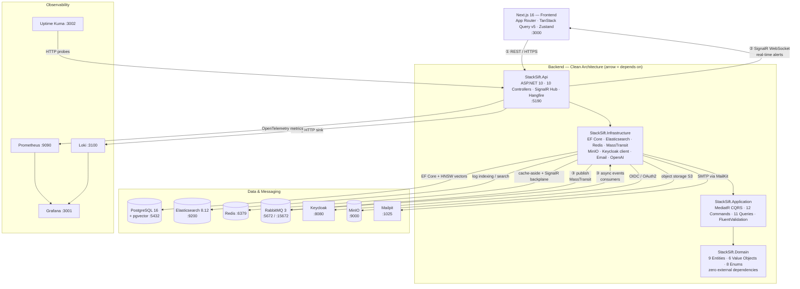

# Architecture

> **StackSift** — AI-Powered SRE & Log-Analysis Platform

## System Diagram

## Legend

| Arrow | Meaning |
|---|---|
| `A → B` inside Backend subgraph | A **depends on** B — strict layer order enforced |
| `A → B` to a service node | A **connects to / uses** B at runtime |
| ① ② ③ | The three client–server message paths (see below) |

**Dependency direction:** `Api → Infrastructure → Application → Domain`
Domain has zero external dependencies; each outer layer may only import the layer directly inside it.

## Message Paths

| # | Protocol | Direction | Purpose |
|---|---|---|---|
| ① | REST / HTTPS | Frontend → API | All CRUD operations and queries |
| ② | SignalR WebSocket | API → Frontend | Real-time alert push notifications (Redis backplane) |
| ③ | RabbitMQ (MassTransit) | Infrastructure ↔ Infrastructure | Async event processing — `LogBatchConsumer`, `AlertFiredConsumer`, DLX retries |

## Infrastructure Services (10 core)

| Service | Port(s) | Role |
|---|---|---|
| PostgreSQL 16 + pgvector | 5432 | Primary DB + vector embeddings (RAG — HNSW cosine) |
| Elasticsearch 8.12 | 9200 | Log indexing and full-text search (`stacksift-logs-{orgId}`) |
| Redis | 6379 | Cache-aside (60 s TTL) + SignalR backplane |
| RabbitMQ 3 | 5672 / 15672 | Async message broker (management UI on 15672) |
| Keycloak | 8080 | Sole identity provider — OAuth2 / OIDC, PKCE, role mappers |
| MinIO | 9000 / 9001 | S3-compatible object storage + console |
| Mailpit | 1025 / 8025 | SMTP sink + email preview UI (dev only) |
| Prometheus | 9090 | Metrics scraping (API, RabbitMQ, Postgres, node) |
| Loki | 3100 | Log aggregation (Serilog HTTP batch sink) |
| Grafana | 3001 | Dashboards — four golden signals, Hangfire queue, RabbitMQ lag, ES indexing |

> **Uptime Kuma** (:3002) ships as an optional Docker Compose profile and probes the `/api/v1/health` endpoint.
> **Optional profiles:** Tempo (distributed tracing), Alertmanager, n8n (workflow automation), Unleash (feature flags).

---

For the full entity-relationship diagram and column details see [docs/database-schema.md](database-schema.md).
