# Database Schema

> **StackSift** — PostgreSQL 16 + pgvector data model. All 13 entities as of Sprint 5.

## Notes before reading

- **Soft-delete base** — every entity below inherits `AuditableEntity<Guid>`, which adds:
  `Id (PK · uuid)`, `CreatedAt`, `UpdatedAt`, `CreatedBy`, `IsDeleted`, `DeletedAt`, `DeletedBy`.
  EF Core applies a global `WHERE IsDeleted = false` query filter on every table.
  `AuditLogEntry` is the one exception — it is append-only with no audit fields.
- **Denormalized `OrganizationId`** — `LogSource`, `LogEntry`, `AlertRule`, `Alert`, `Incident`, and `AiAnalysis` all carry an `OrganizationId` FK even though it is derivable through the ownership chain. This avoids multi-join queries for org-scoped list endpoints and Elasticsearch index routing.
- **pgvector** — `AiAnalysis.Embedding` is a `vector(1536)` column backed by an HNSW index (cosine distance) used for top-3 similar-incident RAG retrieval.
- **Indexes (BE-16)** — three targeted indexes cut hot-query latency by 5–79×; see the [Index table](#be-16-performance-indexes) below.

---

## Entity Relationship Diagram

```mermaid
%%{init: {"er": {"layout": "elk"}}}%%
erDiagram

    Organization {
        uuid        Id                      PK
        string      Name
        string      Slug                    UK
        string      Plan                    "Free / Starter / Pro / Enterprise"
        string      StripeCustomerId        UK  "nullable"
        string      StripeSubscriptionId        "nullable"
        string      SubscriptionStatus          "None / Active / Trialing / PastDue / Canceled"
        datetime    CurrentPeriodEnd            "nullable"
        boolean     CancelAtPeriodEnd
    }

    User {
        uuid        Id                      PK
        uuid        OrganizationId          FK  "nullable"
        uuid        InvitedByUserId         FK  "nullable, self-ref"
        string      Email                   UK  "max 256"
        string      DisplayName
        string      Role                        "Admin / Owner / Member"
        datetime    LastLoginAt                 "nullable"
    }

    Project {
        uuid        Id                      PK
        uuid        OrganizationId          FK
        string      Name
        string      Slug                        "composite UK with OrganizationId"
        string      Description                 "nullable"
        string      Color                       "hex, max 7"
    }

    LogSource {
        uuid        Id                      PK
        uuid        ProjectId               FK
        uuid        OrganizationId          FK  "denormalized"
        string      Name
        string      Type                        "Json / Syslog / CloudWatch / DataDog"
        string      KeyHash                 UK  "HMAC-SHA256, max 64"
        string      KeyPrefix                   "indexed, max 8"
        boolean     IsActive
        datetime    LastSeenAt                  "nullable"
    }

    LogEntry {
        uuid        Id                      PK
        uuid        LogSourceId             FK
        uuid        ProjectId               FK  "denormalized"
        uuid        OrganizationId          FK  "denormalized"
        string      Level                       "Debug / Info / Warning / Error / Critical"
        string      Message
        datetime    Timestamp                   "IX: ProjectId + Timestamp DESC"
        string      TraceId                     "nullable, max 64"
        string      SpanId                      "nullable, max 32"
        string      ServiceName                 "nullable"
        string      HostName                    "nullable"
        jsonb       Metadata                    "flexible key-value bag"
    }

    AlertRule {
        uuid        Id                      PK
        uuid        ProjectId               FK
        uuid        OrganizationId          FK  "denormalized"
        string      Name
        string      Condition                   "ErrorCount / ErrorRate / CustomPattern"
        decimal     Threshold                   "nullable, decimal 18-4"
        int         WindowMinutes
        string      LogLevel                    "nullable, filter condition"
        string      Pattern                     "nullable, regex or keyword"
        string      Severity                    "Low / Medium / High / Critical"
        boolean     IsActive
    }

    Alert {
        uuid        Id                      PK
        uuid        ProjectId               FK
        uuid        OrganizationId          FK  "denormalized"
        uuid        AlertRuleId             FK  "nullable"
        uuid        IncidentId              FK  "nullable"
        string      Title                       "max 500"
        string      Description                 "max 2000"
        string      Severity
        datetime    FiredAt                     "IX: OrgId + FiredAt DESC partial"
        datetime    AcknowledgedAt              "nullable"
        datetime    ResolvedAt                  "nullable"
    }

    Incident {
        uuid        Id                      PK
        uuid        ProjectId               FK
        uuid        OrganizationId          FK  "denormalized"
        uuid        AssigneeId              FK  "nullable, to User"
        uuid        AiAnalysisId            FK  "nullable, 1-to-1"
        string      Title                       "max 500"
        string      Description                 "nullable, max 2000"
        string      Status                      "Open / Acknowledged / Resolved / Closed"
        string      Severity
        datetime    StartedAt                   "IX: OrgId + ProjectId + StartedAt DESC partial"
        datetime    AcknowledgedAt              "nullable"
        datetime    ResolvedAt                  "nullable"
        datetime    ClosedAt                    "nullable"
    }

    AiAnalysis {
        uuid        Id                      PK
        uuid        IncidentId              FK  "1-to-1"
        uuid        OrganizationId          FK  "denormalized"
        string      Status                      "Pending / InProgress / Completed / Failed"
        string      Summary                     "nullable, AI-generated, max 2000"
        string      RootCause                   "nullable, AI-generated, max 2000"
        textArray   SuggestedFixes              "PostgreSQL text array"
        uuidArray   RelevantLogIds              "PostgreSQL uuid array"
        vector      Embedding                   "pgvector 1536 dims"
        float       ConfidenceScore             "nullable, 0.0 to 1.0"
        int         ContextLogCount
        datetime    CompletedAt                 "nullable"
    }

    Invitation {
        uuid        Id                      PK
        uuid        OrganizationId          FK
        uuid        InvitedByUserId         FK
        string      Email                       "max 256"
        string      Role
        string      Token                   UK  "one-time, max 128"
        datetime    ExpiresAt
        datetime    AcceptedAt                  "nullable"
    }

    AccountExportRequest {
        uuid        Id                      PK
        uuid        UserId                  FK
        string      Status                      "Pending / Processing / Completed / Failed"
        datetime    RequestedAt
        string      ObjectKey                   "nullable, S3 path"
        string      SignedUrl                   "nullable, presigned URL"
        string      ManifestSha256              "nullable, integrity hash"
        bigint      SizeBytes                   "nullable"
        datetime    ExpiresAt                   "nullable, URL TTL"
        string      FailureReason               "nullable"
    }

    AccountErasureRequest {
        uuid        Id                      PK
        uuid        UserId                  FK
        string      Status                      "PendingGrace / AwaitingReview / Completed / Failed"
        datetime    RequestedAt
        datetime    GraceEndsAt                 "30-day cancellation window"
        string      CancellationTokenHash       "nullable, HMAC-SHA256"
        string      AwaitingReviewReason        "nullable"
        string      FailureReason               "nullable"
        datetime    CompletedAt                 "nullable"
    }

    AuditLogEntry {
        uuid        Id                      PK  "append-only, no AuditableEntity base"
        uuid        OrganizationId          FK
        uuid        ActorUserId             FK  "nullable"
        string      Event                       "AuditEvent enum"
        uuid        ProjectId                   "nullable, context"
        uuid        LogSourceId                 "nullable, context"
        uuid        TargetId                    "nullable, polymorphic"
        string      TargetType                  "nullable, max 100"
        string      Details                     "nullable, JSON max 2000"
        datetime    OccurredAt                  "IX: OrgId + OccurredAt"
    }

    StripeWebhookEvent {
        uuid        Id                      PK
        string      EventId                 UK  "Stripe evt idempotency key"
        string      EventType                   "e.g. customer.subscription.updated"
        datetime    ReceivedAt
        datetime    ProcessedAt                 "nullable"
        string      ProcessingError             "nullable, max 2000"
        text        PayloadJson                 "full webhook payload"
    }

    %% ── Ownership chain ──────────────────────────────────────────
    Organization ||--o{ Project             : "owns"
    Organization ||--o{ User                : "has members"
    Organization ||--o{ Invitation          : "sends"
    Organization ||--o{ AuditLogEntry       : "records"

    Project      ||--o{ LogSource           : "has"
    Project      ||--o{ AlertRule           : "has"
    Project      ||--o{ Incident            : "has"

    LogSource    ||--o{ LogEntry            : "produces"

    AlertRule    ||--o{ Alert               : "fires"

    %% ── Incident lifecycle ───────────────────────────────────────
    Incident     ||--o{ Alert               : "groups"
    Incident     ||--o| AiAnalysis          : "analyzed by"
    Incident     }o--o| User                : "assigned to"

    %% ── User relations ───────────────────────────────────────────
    User         ||--o{ Invitation          : "creates"
    User         ||--o{ AccountExportRequest  : "GDPR export"
    User         ||--o{ AccountErasureRequest : "GDPR erasure"

```

---

## BE-16 Performance Indexes

Three indexes added in the Sprint 3 SQL optimisation pass. All are partial indexes that exclude soft-deleted rows.

| Index name | Table | Columns | Filter | Effect |
|---|---|---|---|---|
| `IX_Incidents_OrgId_ProjectId_StartedAt_Active` | Incidents | `(OrganizationId, ProjectId, StartedAt DESC)` | `IsDeleted = false AND Status IN ('Open', 'Acknowledged')` | Incident pagination: **34.9 ms → 0.44 ms (79×)** |
| `IX_Alerts_OrgId_FiredAt_Active` | Alerts | `(OrganizationId, FiredAt DESC) INCLUDE (Severity)` | `IsDeleted = false` | Active alert count: **104.5 ms → 18.8 ms (5.6×)** |
| *(correlated subquery)* | Projects | N/A — query rewrite, no new index | — | Projects-with-counts N+1: **~458 ms / 21 queries → 6.0 ms / 1 query (76×)** |

---

## Additional indexes (from entity configurations)

| Table | Column(s) | Type | Purpose |
|---|---|---|---|
| Users | `Email` | Unique | Login lookup |
| Organizations | `Slug` | Unique | URL routing |
| Organizations | `StripeCustomerId` | Unique filtered (IS NOT NULL) | Stripe webhook lookup |
| LogSources | `KeyHash` | Unique | API-key auth on log ingest |
| LogSources | `KeyPrefix` | Index | Fast prefix match before HMAC verify |
| LogEntries | `(ProjectId, Timestamp DESC)` | Composite | Time-ordered log pagination |
| Invitations | `Token` | Unique | One-time invite token lookup |
| Invitations | `Email` | Unique filtered (AcceptedAt IS NULL) | One pending invite per email |
| AccountExportRequests | `(UserId)` | Unique filtered (Status = 'Pending') | One pending export per user |
| AccountErasureRequests | `(UserId)` | Unique filtered (Status IN grace/review) | One active erasure per user |
| AuditLogEntries | `(OrganizationId, OccurredAt)` | Composite | Org-scoped audit feed |
| AuditLogEntries | `(Event, OccurredAt)` | Composite | Event-type filtering |
| StripeWebhookEvents | `EventId` | Unique | Idempotent webhook processing |
